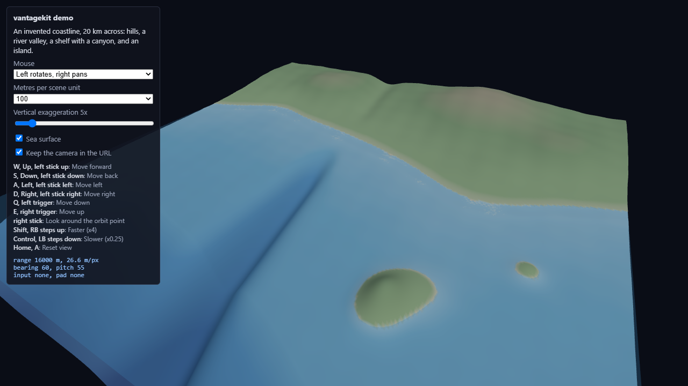

# vantagekit



*The demo page, an invented coastline built in the page with no data service. The side panel lists the bindings and the live range, metres per pixel, bearing and pitch.*

Shared navigation for viewers of Earth-system model domains: terrain, seabed, ocean and atmosphere
scenes in the browser. It sits on top of
[camera-controls](https://github.com/yomotsu/camera-controls) and adds what each viewer otherwise
writes for itself:

- **Zoom that keeps going.** camera-controls' `infinityDolly` and `dollyToCursor` are on by
  default: zooming in past the minimum distance moves the orbit point ahead toward the cursor, so
  scrolling carries you into a scene instead of slowing as you near the orbit point.
- **Keyboard and gamepad input in real units.** WASD, Q/E and the arrow keys move at a speed in
  metres per second, independent of frame rate. An Xbox-style controller (standard mapping) moves,
  looks around and resets the view.
- **Scale and exaggeration aware.** Speeds and links are expressed in metres, whatever the scene
  unit and the vertical exaggeration.
- **Framing helpers.** `fitBox`, `placeView` (bearing, elevation, distance), `saveHome` and `home`,
  and `rescaleVertical` to keep the view steady when the exaggeration changes.
- **Camera links.** The camera is written to the page URL and restored on load, in a geographic
  format that other renderers (for example a map library) can read.

The core (`vantagekit.js`) has no renderer dependency. The three.js adapter
(`vantagekit-three.js`) takes three.js and camera-controls as arguments, so a page keeps a single
copy of three.js however it loads it.

## Use

```html
<script type="importmap">
{
  "imports": {
    "three": "https://cdn.jsdelivr.net/npm/three@0.170.0/build/three.module.js",
    "camera-controls": "https://cdn.jsdelivr.net/npm/camera-controls@3.1.2/dist/camera-controls.module.min.js",
    "vantagekit/three": "https://cdn.jsdelivr.net/gh/lhzn-io/vantagekit@v0.1.0/vantagekit-three.js"
  }
}
</script>
<script type="module">
import * as THREE from 'three';
import CameraControls from 'camera-controls';
import { createVantage } from 'vantagekit/three';

const nav = createVantage({
  THREE, CameraControls, camera, dom: renderer.domElement,
  origin: { lon: -70.5, lat: 42.5 },   // scene origin, for geographic links
  metresPerUnit: 100,                  // one scene unit is 100 m
  exaggeration: () => settings.exag,   // vertical exaggeration, read when needed
  mouse: 'pan-left',                   // or 'rotate-left'
  link: true,                          // keep the camera in the URL
});

nav.readLink();                        // early: read a linked camera, if any
// ... build the scene ...
nav.fitBox(new THREE.Box3().setFromObject(terrain));
nav.saveHome();
nav.applyLink();                       // after the first framing

const clock = new THREE.Clock();
renderer.setAnimationLoop(() => {
  if (nav.update(clock.getDelta()) || needsRender) renderer.render(scene, camera);
});
</script>
```

Pin exact versions of three.js, camera-controls and vantagekit.

## API

`createVantage(options)` returns a controller (an `EventTarget`):

| Member | Purpose |
|---|---|
| `update(dt)` | Advance one frame; returns `true` when the camera moved |
| `controls` | The camera-controls instance, for anything not wrapped here |
| `getTarget(out)`, `getPosition(out)`, `setLookAt(eye, target, animate)` | Camera access |
| `placeView({ target, bearingDeg, elevationDeg, distance, animate })` | Place the eye around a target |
| `fitBox(box3, { bearingDeg, elevationDeg, factor })` | Frame a bounding box |
| `saveHome()`, `home(animate)` | Remember and return to a view (Home key, pad A) |
| `rescaleVertical(prev, next, anchorY)` | Keep a point steady when the exaggeration changes |
| `view()`, `setView(view, animate)` | Renderer-neutral view state |
| `readLink()`, `applyLink()`, `writeLink()` | Camera links in the URL |
| `viewInfo()` | Eye, target, range and metres per pixel, for level of detail and screen-space sizes |
| `press(intent)`, `release(intent)` | Drive movement from your own controls |
| `bindings` | Key and pad bindings, for a help panel |
| `setEnabled(on)`, `setOrigin(origin)`, `dispose()` | Lifecycle |

Events: `move`, `rest`, `input` (`mouse`, `keyboard` or `gamepad`), `gamepad` (connected or
disconnected), `link` (URL rewritten), `recover` (a non-finite camera was reset to the last good
view).

## View links

```
?cv=1&cam=lon,lat,h,range,bearing,pitch
```

The orbit target (longitude and latitude to 6 decimals), its true height in metres (the scene
height divided by the exaggeration), the eye distance in rendered metres, and the look direction:
bearing in degrees clockwise from north, pitch in degrees from straight down. Scenes without an
origin write `cf=local` with east and north metres in place of longitude and latitude. Links
without `cv` are read as six scene-unit numbers (eye, then target) for older pages. The link is
rewritten (with `history.replaceState`) on the first still frame after the camera moves. Other URL
parameters and the hash are preserved; pages add their own through the `link.app` hook.

## Development

```
npm install
npm test                       # Node, no GPU or browser needed
python3 -m http.server 8000    # then open http://localhost:8000/demo/
```

## Licence

MIT. Copyright (c) 2026 Long Horizon Observatory.
