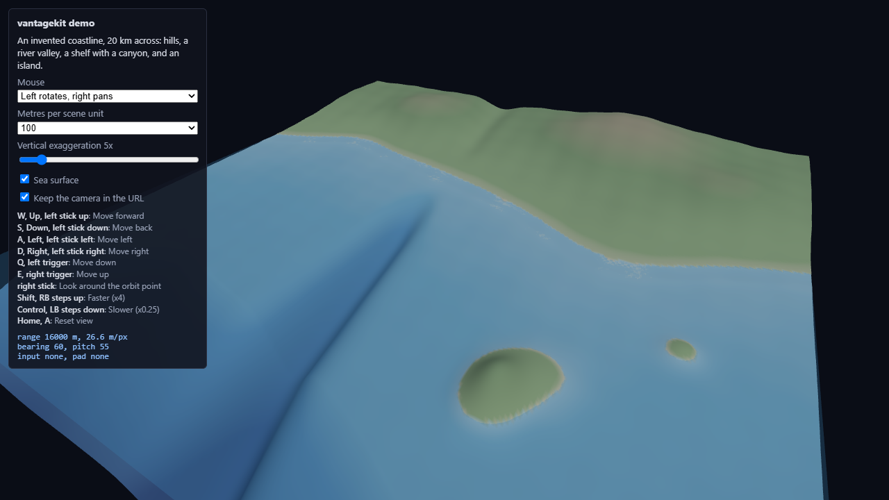

# vantagekit



*The demo page on Montauk Point, Long Island: a 9.1 by 6.0 km topobathymetric grid at 3.8 m from NOAA survey data, served for the demo by [data.lhzn.io](https://data.lhzn.io). The Scene menu also offers an invented coastline built in the page with no data service. The side panel lists the sources, the bindings, and the live range, meters per pixel, bearing and pitch.*

**<a href="demo/index.html">Open the live demo</a>** (mouse, keyboard, gamepad or touch). The
{doc}`demo` page lists its URL parameters and the MapLibre demo.

Shared navigation for viewers of Earth-system model domains: terrain, seabed, ocean and atmosphere
scenes in the browser. It sits on top of
[camera-controls](https://github.com/yomotsu/camera-controls) and adds what each viewer otherwise
writes for itself:

- **Zoom that keeps going.** camera-controls' `infinityDolly` and `dollyToCursor` are on by
  default: zooming in past the minimum distance moves the orbit point ahead toward the cursor, so
  scrolling carries you into a scene instead of slowing as you near the orbit point.
- **Orbit and fly modes, chosen by the page.** Orbit circles a point in the scene, map style. Fly
  is a game-style camera: mouse look (pointer lock, or drag), WASD where you look, the wheel sets
  the speed. A page offers both (F switches, Esc leaves fly) or fixes one.
- **Keyboard and gamepad input in real units.** WASD, Q/E (or Space/C) and the arrow keys move at a
  speed in meters per second, independent of frame rate. An Xbox-style controller (standard
  mapping) moves, looks around, switches mode and resets the view.
- **Touch in both modes.** Orbit gestures follow the mouse preset (one finger does what the left
  button does; pinch zooms by the finger ratio, as on a map). In fly mode one finger looks around,
  two fingers move like a stick (or an optional on-screen joystick moves) and pinching sets the
  speed.
- **Scale and exaggeration aware.** Speeds and links are expressed in meters, whatever the scene
  unit and the vertical exaggeration.
- **Framing helpers.** `fitBox`, `placeView` (bearing, elevation, distance), `saveHome` and `home`,
  and `rescaleVertical` to keep the view steady when the exaggeration changes.
- **Camera links.** The camera is written to the page URL and restored on load, in a geographic
  format that other renderers (for example a map library) can read.

The core (`vantagekit.js`) has no renderer dependency. The three.js adapter
(`vantagekit-three.js`) takes three.js and camera-controls as arguments, so a page keeps a single
copy of three.js however it loads it. The MapLibre adapter (`vantagekit-maplibre.js`, see
{doc}`maplibre`) brings the keys, the gamepad and fly mode to a MapLibre GL JS map.

The Python package (`pip install vantagekit`) carries the same navigation ideas to Omniverse Kit
viewers; see {doc}`kit`.

```{toctree}
:maxdepth: 2
:caption: Browser

usage
orbit-and-fly
orbit-pivot
object-viewers
keyboard-scope
touch
maplibre
view-links
demo
```

```{toctree}
:maxdepth: 2
:caption: Omniverse Kit and Python

kit
```

```{toctree}
:maxdepth: 2
:caption: Reference

js-api
python-api
development
```
